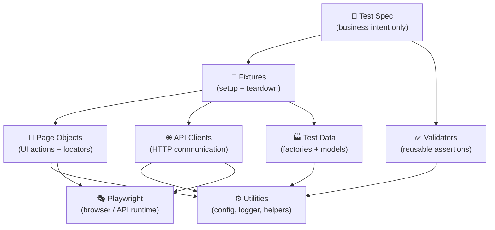

# 🎭 Playwright SDET Framework

> **TypeScript · Playwright · REST API · CI/CD · Allure**
> A production-grade test automation framework that tests **websites (UI)** and **backend services (API)** together, cleanly and reliably.

---

## 📑 Table of Contents

| # | Section | # | Section |
|---|---------|---|---------|
| 1 | [🧠 What Is This?](#1--what-is-this) | 10 | [🔩 Fixtures](#10--fixtures) |
| 2 | [🏗️ Architecture](#2-️-architecture) | 11 | [🏭 Test Data Factories](#11--test-data-factories) |
| 3 | [📂 Folder Structure](#3--folder-structure) | 12 | [🔐 Authentication](#12--authentication) |
| 4 | [📜 Golden Rules](#4--golden-rules) | 13 | [⚡ Parallel Execution](#13--parallel-execution) |
| 5 | [🚀 Quick Start](#5--quick-start) | 14 | [📊 Reporting](#14--reporting) |
| 6 | [⚙️ Environment Setup](#6-️-environment-setup) | 15 | [🐞 Debugging](#15--debugging) |
| 7 | [▶️ Running Tests](#7-️-running-tests) | 16 | [🔄 CI/CD](#16--cicd) |
| 8 | [🧪 Three Kinds of Tests](#8--three-kinds-of-tests) | 17 | [➕ How to Add Things](#17--how-to-add-things) |
| 9 | [📄 Page Objects](#9--page-objects) | 18 | [⚠️ Common Mistakes](#18-️-common-mistakes) |
| | | 19 | [🤖 AI Workflow](#19--ai-augmented-workflow) |
| | | 20 | [🔌 Extension Points](#20--extension-points) |
| | | 21 | [✅ 20-Rule Production Bar](#21--20-rule-production-bar) |

---

## 1. 🧠 What Is This?

Think of this framework as a **well-run restaurant** 🍽️:

| 🍽️ Restaurant | 🧪 This Framework |
|---|---|
| **Customer order** (what they want) | **Test spec**: states the business goal |
| **Waiter** (takes the order, coordinates) | **Fixtures**: prepare everything the test needs |
| **Chefs** (do the actual cooking) | **Page Objects** (click the UI) & **API Clients** (talk to the backend) |
| **Food inspector** (checks quality) | **Validators**: reusable checks |
| **Ingredient supplier** (fresh every time) | **Test Data Factories**: make unique data for every test |
| **Kitchen tools & settings** | **Utilities**: config, logger, helpers |
| **The stove & ovens** | **Playwright**: the engine that drives browsers/HTTP |

> 💡 **Key idea:** The customer (test) never walks into the kitchen. Tests only say *what* they want; the layers below know *how* to do it.

---

## 2. 🏗️ Architecture

Tests sit on **top** and stay **thin**. Arrows point **downward only**: lower layers never depend on tests.



### 🧱 Who owns what?

| Layer | 📍 Location | 🎯 Owns | 🗣️ In plain English |
|---|---|---|---|
| 🧪 **Test Specs** | `test/` | Business flow | "What are we proving?" |
| 🔩 **Fixtures** | `fixtures/` | Setup, teardown, injection | "Get everything ready, clean up after." |
| 📄 **Page Objects** | `ui/pages/` | Locators, UI actions | "How do I click/type on this page?" |
| 🌐 **API Clients** | `api/clients/` | HTTP requests and responses | "How do I talk to the backend?" |
| ✅ **Validators** | `ui/validators/` | Shared assertions | "Is the result correct?" |
| 🏭 **Test Data** | `test-data/` | Factories, models | "Give me a brand-new fake user." |
| ⚙️ **Utilities** | `utils/` | Config, logger, helpers | "Shared small tools." |

---

## 3. 📂 Folder Structure

```
📦 playwright-sdet-framework/
│
├── 🌐 api/                          ← Everything about talking to the backend
│   ├── 📁 clients/
│   │   ├── api.client.ts            ← 🧱 Base HTTP client (auth, headers, logging)
│   │   ├── auth.client.ts           ← 🔑 Login, refresh, logout
│   │   └── user.client.ts           ← 👤 Create / read / update / delete users
│   └── api.types.ts                 ← 📐 Typed request/response shapes
│
├── 🖥️ ui/                           ← Everything about the browser
│   ├── 📁 pages/
│   │   ├── login.page.ts            ← 🔐 Login page actions
│   │   ├── home.page.ts             ← 🏠 Inventory / home page actions
│   │   └── ui.types.ts              ← 📐 UI types + route constants
│   └── 📁 validators/
│       ├── order.validator.ts       ← 🧾 Order checks
│       └── header.validator.ts      ← 🧭 Navigation / header checks
│
├── 🧪 test/                         ← The actual tests (thin!)
│   ├── login.flow.spec.ts           ← 🖥️ UI login tests
│   ├── checkout.flow.spec.ts        ← 🔀 API + UI hybrid checkout tests
│   └── user.lifecycle.spec.ts       ← 🌐 Pure API tests
│
├── 🔩 fixtures/                     ← Setup & teardown, injected into tests
│   ├── browser.fixture.ts           ← All custom Playwright fixtures
│   └── test.context.ts              ← Per-test context interface
│
├── 🏭 test-data/                    ← Fresh, unique data for every test
│   ├── 📁 factories/
│   │   ├── user.factory.ts          ← 👤 UserFactory (Faker-based)
│   │   ├── order.factory.ts         ← 🛒 OrderFactory
│   │   └── index.ts                 ← 📦 Barrel export
│   └── 📁 models/
│       ├── user.model.ts            ← 👤 User shape
│       └── order.model.ts           ← 🛒 Order shape
│
├── ⚙️ utils/                        ← Shared small tools
│   ├── config.ts                    ← 🔧 Env-driven settings + validation
│   ├── logger.ts                    ← 📝 Structured logger (no secrets!)
│   ├── api.utils.ts                 ← 🌐 Response helpers, URL builders
│   └── common.utils.ts              ← 🧰 Retry, sleep, masking, deep-equals
│
├── 🔄 .github/workflows/ci.yml      ← GitHub Actions pipeline
├── 📊 reports/allure/               ← Allure output (git-ignored)
├── 🎛️ playwright.config.ts          ← Browsers, reporters, CI settings
├── 🔒 tsconfig.json                 ← Strict TypeScript
├── 📦 package.json                  ← Scripts + dependencies
├── 🔑 .env.example                  ← Safe template for secrets
└── 📖 README.md
```

### 🧭 "I want to…" cheat sheet

| 🎯 I want to… | 📍 Go to |
|---|---|
| Change how a button is found | `ui/pages/*.page.ts` |
| Call a new backend endpoint | `api/clients/*.client.ts` |
| Create fake users/orders | `test-data/factories/` |
| Share a setup step across tests | `fixtures/browser.fixture.ts` |
| Add a reusable "check" | `ui/validators/` |
| Change URLs or credentials | `.env` (read via `utils/config.ts`) |
| Write a new test | `test/*.spec.ts` |

---

## 4. 📜 Golden Rules

### 🧪 Tests
1. ✅ Tests are the **last, thinnest layer**. No framework logic in specs.
2. ✅ Tests should **read like business requirements**.
3. ✅ **No duplicated logic**: write once, reuse everywhere.

### 🎯 Locators and assertions
4. 📍 **Locators live only in Page Objects.**
5. ✅ **Assertions live in Page Objects or Validators**, not scattered in specs.
6. 🎯 Prefer **semantic locators**: `getByRole` > `getByLabel` > `getByTestId`.
7. 🚫 **Never use `waitForTimeout()`.** Use Playwright's auto-waiting and web-first assertions.

### 🌐 API and data
8. 🌐 The **API layer owns all HTTP**: no `request.get()` in tests.
9. 🏭 **All test data comes from factories**: no inline `{ email: 'test@test.com' }`.
10. 🔀 **API sets up preconditions**; the UI does so only when UI behavior is under test.
11. 🧍 **Every test gets isolated data**, so it is parallel-safe.
12. 🚫 **No shared mutable JSON data.**

### 🔐 Config and safety
13. 🔧 **Config comes from environment variables**, never hardcoded.
14. 🔒 **Secrets never in code**: use `.env` and GitHub Secrets.

### 🧹 Quality
15. ⚡ **Parallel by default**: no shared mutable state.
16. 🔄 **CI-friendly from day one**: retries, artefacts, matrix builds.
17. 🧼 **Simple over clever**: readable beats over-engineered.
18. 🔁 **Framework-agnostic architecture**: easy to adapt or migrate.

---

## 5. 🚀 Quick Start

**Prerequisites:** 🟢 Node.js ≥ 18 · 📦 npm ≥ 9

```bash
# 1️⃣ Clone
git clone https://github.com/your-org/playwright-sdet-framework.git
cd playwright-sdet-framework

# 2️⃣ Install dependencies
npm install

# 3️⃣ Install browsers
npx playwright install

# 4️⃣ Configure environment
cp .env.example .env
# ✏️ Edit .env with your real values
```

---

## 6. ⚙️ Environment Setup

Settings are loaded from environment variables by `utils/config.ts`.

| Variable | Required | Description |
|---|:---:|---|
| `BASE_URL` | ✅ | 🌍 Web app URL |
| `API_BASE_URL` | ✅ | 🌐 REST API base URL |
| `TEST_USERNAME` | ✅ | 👤 Default test user email |
| `TEST_PASSWORD` | ✅ | 🔑 Default test user password |
| `TEST_ENV` | ✅ | 🏷️ `local` / `dev` / `staging` / `prod` |
| `CI` | 🤖 auto | Set to `true` in GitHub Actions |
| `WORKERS` | ➖ optional | ⚡ Parallel workers (default: 4) |

> [!CAUTION]
> 🚨 **Never commit `.env`.** It's in `.gitignore`. Use GitHub repository secrets for CI.

---

## 7. ▶️ Running Tests

| 🎯 Goal | 💻 Command |
|---|---|
| ▶️ Run everything | `npm test` |
| 🎬 Playwright UI runner | `npm run test:ui` |
| 👀 Watch the browser (headed) | `npm run test:headed` |
| 🐛 Debug step by step | `npm run test:debug` |
| 🟡 Chromium only | `npm run test:chromium` |
| 🦊 Firefox only | `npm run test:firefox` |
| 🧭 WebKit only | `npm run test:webkit` |
| 🌐 API tests only | `npm run test:api` |
| 🔍 Type check | `npm run typecheck` |
| 🧹 Lint | `npm run lint` |
| 💅 Format | `npm run format` |

---

## 8. 🧪 Three Kinds of Tests

| Type | 🖥️ UI | 🌐 API | 🔀 Hybrid |
|---|:---:|:---:|:---:|
| **Uses browser?** | ✅ | ❌ | ✅ |
| **Uses API clients?** | ❌ | ✅ | ✅ |
| **Example file** | `login.flow.spec.ts` | `user.lifecycle.spec.ts` | `checkout.flow.spec.ts` |
| **Best for** | Testing the screen itself | Testing backend logic | Testing real user features ⭐ |

### 🖥️ UI test: *"Does the screen behave correctly?"*

```typescript
// test/login.flow.spec.ts
import { test } from '../fixtures/browser.fixture';
import { config } from '../utils/config';

test('valid credentials allow the user to log in', async ({ loginPage }) => {
  await loginPage.navigate();
  await loginPage.login(config.username, config.password);
  await loginPage.verifyLoginSuccess();
});
```

### 🌐 API test: *"Does the backend behave correctly?"*

```typescript
// test/user.lifecycle.spec.ts
import { test, expect } from '../fixtures/browser.fixture';
import { UserFactory } from '../test-data/factories';

test('can create a new user via API', async ({ userClient }) => {
  const userData = UserFactory.create();

  const created = await userClient.createUser({
    firstName: userData.firstName,
    email: userData.email,
    // ...
  });

  expect(created.id).toBeTruthy();
  expect(created.email).toBe(userData.email);
});
```

### 🔀 Hybrid test (⭐ recommended): *"Set up fast, verify where it matters"*

```
🌐 API creates the precondition   (fast ⚡)
        ⬇️
🖥️ UI performs the real action    (what we're testing 🎯)
        ⬇️
✅ API or UI validates the result
```

```typescript
test('authenticated user can checkout', async ({
  loginPage,
  homePage,
  testUser,        // 👈 created via API inside the fixture
}) => {
  await loginPage.navigate();
  await loginPage.login(testUser.email, testUser.password);
  await loginPage.verifyLoginSuccess();

  await homePage.addProductToCart('Product Name');
  await homePage.checkout();

  await homePage.verifyOrderConfirmationShown();
});
```

**💡 Why hybrid?**
- ⚡ API setup is **10–50× faster** than clicking through the UI
- 🛡️ **Fewer failure points** in preconditions
- 🎯 Tests validate **the feature**, not the setup

---

## 9. 📄 Page Objects

A Page Object is a **remote control for one page** 🎮: tests press high-level buttons ("log in"), and the object knows which exact elements to touch.

**Every Page Object:**
- 🏷️ Is a class that receives a `Page`
- 🔒 Keeps locators `private`
- 🎬 Exposes only **high-level actions** (`login()`, `checkout()`)
- ✅ Has **`verify*()`** methods for assertions

```typescript
class LoginPage {
  private readonly usernameInput: Locator;
  private readonly passwordInput: Locator;
  private readonly loginButton: Locator;

  async login(username: string, password: string): Promise<void> {
    await this.usernameInput.fill(username);
    await this.passwordInput.fill(password);
    await this.loginButton.click();
  }

  async verifyLoginSuccess(): Promise<void> {
    await expect(this.page).toHaveURL(/inventory/);
  }
}
```

### 🎯 Locator priority (best → last resort)

| Priority | Locator | Why |
|:---:|---|---|
| 🥇 | `getByRole()` | Matches how users & screen readers see the page |
| 🥈 | `getByLabel()` | Stable form-field targeting |
| 🥉 | `getByTestId()` | Explicit, developer-provided hook |
| 4️⃣ | `getByText()` | OK, but breaks if copy changes |
| ⛔ | CSS / XPath | Only when truly unavoidable |

---

## 10. 🔩 Fixtures

Fixtures are **pre-packed toolkits** 🧰 handed to each test automatically.

```typescript
import { test, expect } from '../fixtures/browser.fixture';
```

| 🔩 Fixture | 🏷️ Type | 📝 What you get |
|---|---|---|
| `loginPage` | `LoginPage` | 🔐 Login page object |
| `homePage` | `HomePage` | 🏠 Home/inventory page object |
| `authClient` | `AuthClient` | 🔑 Pre-configured auth API client |
| `userClient` | `UserClient` | 👤 Pre-configured user API client |
| `freshUser` | `UserModel` | 🆕 Generated user (**not** saved in backend) |
| `testUser` | `PersistedUser` | 💾 API-created user, **auto-deleted after test** 🧹 |
| `authenticatedRequest` | `APIRequestContext` | 🔓 Pre-authenticated request context |

> 🧩 Fixtures are **composable**: each depends only on lower-layer fixtures.

---

## 11. 🏭 Test Data Factories

Factories are **fake-data vending machines** 🎰: press a button, get a unique user/order.

```typescript
import { UserFactory, OrderFactory } from '../test-data/factories';

const user   = UserFactory.create();                        // 👤 one user
const admin  = UserFactory.create({ role: 'admin' });       // 👑 with overrides
const users  = UserFactory.createMany(5);                   // 👥 five unique users
const order  = OrderFactory.create({ userId: 'user-id-123' }); // 🛒 order for a user
```

| ✅ Do | ❌ Don't |
|---|---|
| Generate data in factories | Call `faker.*` directly in specs |
| Get unique data per call | Use static JSON files |
| Override only what matters | Hardcode emails in tests |

---

## 12. 🔐 Authentication

| Method | 🎯 When to use | 📝 How |
|---|---|---|
| 🥇 **API login** | Default for almost all tests | Done automatically by the `testUser` fixture |
| 🖥️ **UI login** | **Only** when testing the login feature itself | `loginPage.login(...)` |
| 💾 **Storage state** | Reuse a session across tests | Enable `setup` project in `playwright.config.ts` |

```typescript
// 🥇 API auth (preferred)
const authClient = new AuthClient(request);
await authClient.login(config.username, config.password);
// 🎟️ Token is stored on the client instance
```

> [!WARNING]
> 🚨 Never commit `.auth/user.json`. It contains session tokens. (It's git-ignored.)

---

## 13. ⚡ Parallel Execution

The framework is **parallel-safe by design**:

- ✅ Each test generates its **own user**
- ✅ Each test creates API resources in fixtures and **tears them down**
- ✅ **No shared mutable state**
- ✅ **No ordering assumptions** between tests
- ✅ **Independent browser contexts** per test
- ✅ `fullyParallel: true` in `playwright.config.ts`

```bash
WORKERS=8 npm test      # 🚀 one-off
# or set WORKERS=4 in .env
```

---

## 14. 📊 Reporting

| Report | ▶️ Generate | 📂 Output |
|---|---|---|
| 🎭 **Playwright HTML** | `npm test` then `npm run report` | `playwright-report/` |
| 🌈 **Allure (live)** | `npm test` then `npm run allure` | `reports/allure/` |
| 🌈 **Allure (static)** | `npm run allure:generate` | `reports/allure/` |

---

## 15. 🐞 Debugging

| 🎯 Goal | 💻 Command |
|---|---|
| 🔍 Step-by-step inspector | `npm run test:debug` |
| 👀 See the browser | `npm run test:headed` |
| 📄 Run one file | `npx playwright test test/login.flow.spec.ts --headed` |
| 🔎 Run by title | `npx playwright test --grep "valid credentials"` |
| 📢 Verbose logs | `DEBUG=true npm test` |
| 🎞️ Replay a failure trace | `npx playwright show-trace test-results/**/trace.zip` |

---

## 16. 🔄 CI/CD

GitHub Actions pipeline: `.github/workflows/ci.yml`

```
📥 push / pull request
   │
   ▼
🧹 quality        → lint + typecheck + format
   │
   ▼
🟡 test           → Chromium (runs on every PR)
   │
   ▼
🌍 cross-browser  → Firefox + WebKit (main branch only)
```

**🔑 Required GitHub Secrets**

| Secret | Description |
|---|---|
| `BASE_URL` | 🌍 Application URL |
| `API_BASE_URL` | 🌐 API base URL |
| `TEST_USERNAME` | 👤 Test account username |
| `TEST_PASSWORD` | 🔑 Test account password |
| `TEST_ENV` | 🏷️ Target environment |

**📎 Artefacts uploaded on failure:** 🎭 Playwright report · 🌈 Allure results · 🎞️ traces · 📸 screenshots · 🎥 videos

---

## 17. ➕ How to Add Things

### 📄 A. New Page Object

1. **Create** `ui/pages/my-feature.page.ts`
   ```typescript
   import { expect, Locator, Page } from '@playwright/test';

   export class MyFeaturePage {
     private readonly page: Page;
     private readonly someElement: Locator;

     constructor(page: Page) {
       this.page = page;
       this.someElement = page.getByRole('button', { name: /action/i });
     }

     async doSomething(): Promise<void> {
       await this.someElement.click();
     }

     async verifySomething(): Promise<void> {
       await expect(this.someElement).toBeVisible();
     }
   }
   ```
2. **Register** it in `fixtures/browser.fixture.ts`
   ```typescript
   myFeaturePage: async ({ page }, use) => {
     await use(new MyFeaturePage(page));
   },
   ```
3. **Add the type** to the `TestFixtures` interface in the same file.

### 🌐 B. New API Client

1. **Create** `api/clients/product.client.ts`
   ```typescript
   import { APIRequestContext } from '@playwright/test';
   import { ApiClient } from './api.client';
   import { ProductResponse } from '../api.types';
   import { assertOkAndParse } from '../../utils/api.utils';

   export class ProductClient extends ApiClient {
     constructor(request: APIRequestContext) {
       super(request);
     }

     async getProduct(id: string): Promise<ProductResponse> {
       const response = await this.get(`/products/${id}`);
       return assertOkAndParse<ProductResponse>(response, 'GET', `/products/${id}`);
     }
   }
   ```
2. **Add types** to `api/api.types.ts`
3. **Register** in `fixtures/browser.fixture.ts` if tests need it

### 🧪 C. New Test

1. **Create** `test/my-feature.spec.ts`
   ```typescript
   import { test } from '../fixtures/browser.fixture';

   test.describe('My Feature', () => {
     test('user can perform the feature action', async ({ loginPage, myFeaturePage, testUser }) => {
       await loginPage.navigate();
       await loginPage.login(testUser.email, testUser.password);

       await myFeaturePage.doSomething();
       await myFeaturePage.verifySomething();
     });
   });
   ```
2. 🎯 Describe **business intent**, not implementation
3. 🔩 Get page objects, clients and data from **fixtures**
4. ✅ Add a **validator** if an assertion will be reused

---

## 18. ⚠️ Common Mistakes

| ❌ Mistake | ✅ Do this instead |
|---|---|
| `page.locator('#login-btn')` in a test | Put the locator in a Page Object |
| `request.post('/users', {...})` in a test | Use `userClient.createUser(...)` |
| `faker.internet.email()` in a spec | Use `UserFactory.create()` |
| `await page.waitForTimeout(2000)` | Rely on auto-waiting + web-first assertions |
| Hardcoded `'admin@example.com'` | Read from `config.username` |
| Sharing one user across tests | Create isolated data per test |
| Only `expect(response.status()).toBe(200)` | Also validate the response body |
| Setting up preconditions with UI clicks | Use the API |
| `console.log('password:', password)` | **Never** log credentials |
| One giant `utils.ts` with 50 functions | Split by concern (`api.utils.ts`, `common.utils.ts`) |

---

## 19. 🤖 AI-Augmented Workflow

Works great with GitHub Copilot, Claude, Gemini and similar assistants, but **is fully functional without any AI**.

| 📋 Task | 🤖 AI help? | ⚠️ Risk |
|---|---|:---:|
| Generate a new Page Object | ✅ High value | 🟢 Low |
| Generate a new API client | ✅ High value | 🟢 Low |
| Generate a data factory | ✅ High value | 🟢 Low |
| Draft test scenarios from requirements | ✅ High value | 🟢 Low |
| Identify edge cases | ✅ High value | 🟢 Low |
| Refactor duplicate locators | ✅ High value | 🟢 Low |
| Write selectors for new elements | ⚠️ Verify output | 🟡 Medium |
| Environment configuration | ❌ Don't use AI | 🔴 High |
| Suggestions with hardcoded credentials | 🚫 Reject always | ⛔ Critical |

**💬 Example prompt:**
```
Generate a CheckoutPage page object following the same pattern
as LoginPage in this codebase. Use getByRole() locators.
```

---

## 20. 🔌 Extension Points

| 🚀 Capability | 🔧 Where to plug in |
|---|---|
| 📱 Mobile browsers | Add a project to `playwright.config.ts` |
| ♿ Accessibility | Add `@axe-core/playwright` calls in Validators |
| 👁️ Visual regression | Add `expect(page).toHaveScreenshot()` in Validators |
| 📜 Contract testing | Add a `ContractValidator` in `ui/validators/` |
| 🔮 GraphQL | Add `graphql.client.ts` extending `ApiClient` |
| 🗄️ Database checks | Add a `db/` layer with `db.client.ts` |
| 🐳 Docker | Add `docker-compose.yml` + update CI |
| 🏷️ Test tagging | Use `@smoke` / `@regression` in titles + `--grep` |
| ⏱️ Performance | Run `k6` or Lighthouse as separate npm scripts |
| 🧠 MCP integration | Add `api/clients/mcp.client.ts` |

---

## 21. ✅ 20-Rule Production Bar

### 🎯 Locators and Data
1. 🚫 No CSS/XPath unless unavoidable
2. 👤 Prefer user-facing locators: `getByRole`, `getByLabel`, `getByTestId`
3. 🔗 Never hardcode element IDs that may change between deployments
4. 🚫 No shared mutable JSON test data
5. 🏭 Every test gets unique, factory-generated data

### 🏗️ Structure
6. 📄 One Page Object per major page, with no sprawl
7. ♻️ Reusable actions belong in Page Objects, not test helpers
8. 🎯 Tests describe business flows, not implementation steps
9. 🚫 No duplicate helper methods
10. 📝 Document architectural decisions in this README

### 🌐 API Testing
11. 🧱 Build requests through reusable, typed clients
12. ✅ Validate the response **body**, not only the status code
13. ⚡ Use API calls (not UI clicks) for preconditions
14. 🔁 Verify backend state via API after UI operations
15. 🔩 Prepare API context in fixtures, not in specs

### 🎭 Mocking and Data
16. 📐 One canonical data model per domain (user, order, etc.)
17. 🎭 Mock only when it adds deterministic value (e.g. a payment gateway)
18. 🚫 Don't duplicate mock state across test files

### 👁️ Visual and Accessibility
19. 🔌 Validators are the extension point for visual and a11y checks
20. 📂 Keep visual/a11y tests in **separate** spec files from functional tests

---

_🛠️ Built as a portfolio-grade SDET framework. Adapt selectors and endpoints to your application._